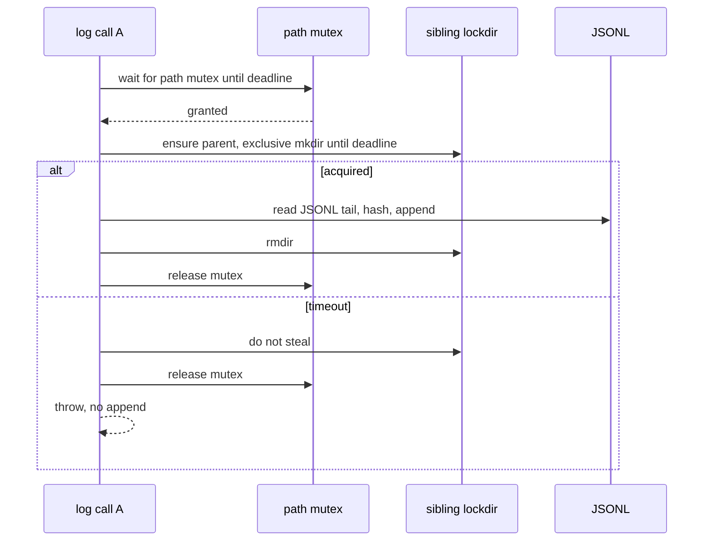

# RSI Audit Log Write Lock - Plan

## Goal Capsule

- **Objective:** Concurrent `RSIAuditLog` appends leave a hash chain that `verifyIntegrity()` accepts. A write that cannot get exclusive access writes no line.
- **Means:** Path-keyed in-process mutex plus a sibling `mkdir` lockdir, both held across read-tail / hash / append (KTD1, KTD2).
- **Authority:** Product Contract requirements, then Key Technical Decisions, then unit approach.
- **Stop:** A design that needs a new npm dependency, edits `src/wallet`, `src/payments`, auto-research shell quoting, `.github/workflows/**`, or cherry-picks GitHub PR #208.
- **Execution profile:** One implementation-ready software plan. One open PR. Do not merge.
- **Who finishes:** Implementer lands the lock and tests. Reviewer (Security Officer) reviews the PR. Merge stays with the user.

---

## Product Contract

### Summary

`RSIAuditLog.log()` today reads the JSONL tail, hashes the new entry against that tail, then appends. Overlapping calls can both see the same last hash and fork the chain. This work serializes that read-compute-append sequence with an in-process mutex and a cross-process exclusive lock, fails closed on acquire timeout, and releases both locks on error.

### Problem Frame

`verifyIntegrity()` treats a forked `previousHash` as tamper. Concurrent writers can mark an honest log invalid without anyone editing the file. Outside PR #208 added an instance-local promise chain only. That does not cover two instances on one path, another process, or a timeout.

### Key Decisions

- In-process mutex plus a cross-process file lock when the same log path is shared. (session-settled: user-directed — chosen over in-process-only: another process can open the same `filePath`.) Governs R1, R2
- The lock covers read previous hash, compute, and append as one critical section. (session-settled: user-directed — chosen over locking only `appendFile`: two readers of the same tail still fork.) Governs R3
- If the lock is not acquired in time, throw and write nothing. Release on error. (session-settled: user-directed — chosen over unlocked fallback or infinite wait: a broken chain is worse than a failed write.) Governs R4, R5
- Tests must prove concurrent appends verify, a thrown write still releases, and timeout writes nothing. (session-settled: user-directed — chosen over lock-helper unit tests only.) Governs R6
- Touch the RSI audit-log lock only. Re-implement in-house. Do not cherry-pick PR #208. (session-settled: user-directed — chosen over adopting that PR: it also changes wallet, payments, auto-research, and `package-lock.json`.) Governs R7, R8

### Requirements

**Lock behavior**

- R1. Concurrent `log()` calls in one process, including two `RSIAuditLog` instances on the same normalized path, serialize so each entry's `previousHash` is the prior entry's `entryHash`.
- R2. Concurrent `log()` calls from separate processes on the same path serialize the same way.
- R3. The lock is held for the whole read-tail, hash, and append sequence in `RSIAuditLog.log()`.
- R4. If either lock cannot be acquired before the timeout, `log()` throws and the JSONL gains no new line.
- R5. A throw inside the locked section still releases both locks so a later `log()` can succeed.

**Verification**

- R6. `tests/rsi/audit.test.ts` covers concurrent-append stress (chain verifies), lock release after a thrown write, and the timeout path.

**Scope**

- R7. Change only the RSI audit-log lock and its tests. Do not edit `src/wallet`, `src/payments`, auto-research shell quoting, or `.github/workflows/**`.
- R8. Do not cherry-pick PR #208 or take its `package-lock.json`. Add no npm dependency unless a KTD records why it is essential. Do not bump `package.json` version, publish, or tag.

### Success Criteria

- After overlapping `log()` calls, `verifyIntegrity()` returns `valid: true` and history length equals the number of successful appends.
- A timeout or thrown write leaves the file unchanged by that call and does not pin the lock.
- The PR body states this re-implements the RSI audit-log lock in-house, replacing that part of outside PR #208, asks for Security Officer review, notes that old unlocked writers must not share a path with the new lock, and must not claim two-process serialization was tested.

### Scope Boundaries

**In scope**

- `src/rsi/audit.ts` and a private lock helper next to it if the class would otherwise grow past one concern.
- `tests/rsi/audit.test.ts` for the three required scenarios.
- Optional constructor options that default so `new RSIAuditLog(path)` stays valid.

**Deferred to Follow-Up Work**

- Read locks on `getHistory` / `verifyIntegrity`.
- Stale-lock steal or crash recovery of a leftover lockdir.
- Hash-chain locks on payments, metrics, mutation, or episodic JSONL files.
- The rest of PR #208 (wallet fail-loud, spending, auto-research quoting).
- README / CHANGELOG / version bump.

**Outside this product's identity**

- Wallet, payments, workflow YAML, publish, tags, secrets.

### Acceptance Examples

- AE1. Covers R1, R3, R6. Given an empty log, when 20 `log()` calls run under `Promise.all` (two instances, one path), then history length is 20 and `verifyIntegrity()` is valid.
- AE2. Covers R5, R6. Given a spy that throws on `appendFile` after the lock is held, when that `log()` rejects, then a later `log()` succeeds and the chain verifies.
- AE3. Covers R4, R6. Given a sibling lockdir already present and a short timeout, when `log()` runs, then it throws, the JSONL is absent or unchanged, and no entry is appended.

---

## Planning Contract

### Key Technical Decisions

- KTD1. **Path-keyed in-process mutex as anti-stampede.** Keep a module-level map from `path.resolve(filePath)` to a FIFO promise chain. Do not store the chain on the instance. The mutex is same-realm only and must not skip the lockdir. R1 and R2 are enforced by KTD2. Mutex wait shares KTD4's wall-clock deadline. A waiter that times out rejects and must not enter the critical section. (session-settled: user-directed — chosen over PR #208's per-instance `writeChain`: two instances on one path still race.)
- KTD2. **Always-on sibling `mkdir` lockdir.** Recursively create `dirname(resolvedPath)` first (existing `ensureDir`). Then exclusive, non-recursive `mkdir` of `${resolvedPath}.lock`. Poll until the shared deadline, then throw. Never unlink a lockdir this process did not create. Under the lock, previousHash is the last parseable line's `entryHash` (today's tail of `getHistory()`). Node 22–26 have no `FileHandle.lock` / `flock`; `wx` exclusive-create is weaker on NFS. Bake-off skipped: both exclusive-create and cheap to reverse. Instantiates R1, R2, R3, R4.
- KTD3. **No new npm dependency.** Challenge of the no-deps directive: `proper-lockfile` is convenience, not required for correctness on Node 22 with `mkdir`. Instantiates R8.
- KTD4. **One acquire deadline, options bag.** `constructor(filePath, options?)` with `lockTimeoutMs` default 5000. Reject non-finite or non-positive at construct. The deadline covers mutex wait and lockdir poll. It is an acquire budget, not a hold-time cap. Timeout throws an unexported error with one stable `name` and a message that includes the lockdir path. Do not export it from `src/index.ts`. Instantiates R4, R6.

### High-Level Technical Design

Lock acquire is two layers. The lockdir is taken only after this process owns the path's mutex, so waiters on the same path do not stampede `mkdir`.

Release both layers in `finally`, lockdir first.

### Assumptions

- File lock is always on, including single-process tests. The library cannot know whether another process will open the same path.
- Path key is `path.resolve(filePath)`. First-write paths often do not exist, so `realpath` is not required.
- Leftover lockdir after a crash makes later writers time out until an operator removes that directory with no live writer. No steal.
- Timeout errors use one unexported stable `name` so tests can distinguish them from I/O failures.
- `tests/integration/rsi-cycle.test.ts` stays unchanged if `log()` remains async and `new RSIAuditLog(path)` still works.
- AE3 is a fail-closed acquire stand-in for R4, not a two-process serialization proof of R2. R2 is a design consequence of exclusive `mkdir` held across read-hash-append. The PR body must not claim two-process serialization was tested.

### Implementation Constraints

- Node `>=22`. Use `node:fs/promises`, `node:path`, `node:timers/promises` only.
- `tsup` bundles `src/index.ts`. A new helper must be imported from `src/rsi/audit.ts`. Do not add a public export unless tests need the timeout error type.
- Do not edit `.github/workflows/**`. Do not force-push. Do not commit secrets.

### Sequencing

U1 mutex, then U2 lockdir inside that mutex, then U3 tests that prove R6. Tests may be written first against the public `log()` surface.

---

## Implementation Units

### U1. Path-keyed in-process write mutex

- **Goal:** Overlapping `log()` calls on one resolved path, including two class instances, run one critical section at a time.
- **Requirements:** R1, R3, R7. Cites KTD1.
- **Dependencies:** none
- **Files:** `src/rsi/audit.ts`, optional `src/rsi/audit-lock.ts`, `tests/rsi/audit.test.ts`
- **Approach:**
  1. Move today's unlocked body of `log()` behind a private append helper.
  2. Wrap it with a module-level FIFO promise chain keyed by `path.resolve(filePath)` per KTD1. Mutex wait uses the KTD4 deadline. A timed-out waiter must not enter the critical section.
  3. Release the mutex in `finally` so a throw does not pin the path.
- **Execution note:** Keep the existing sequential tests green while adding the mutex so `tests/integration/rsi-cycle.test.ts` does not need edits.
- **Patterns to follow:** FIFO waiter from `src/swarm/concurrency.ts` (`acquire` / `release` queue). Do not copy PR #208's instance field.
- **Test scenarios:**
  - Sequential `log()` still writes a valid two-entry chain (existing cases stay green).
  - Two instances on one file using two path spellings that `path.resolve` to the same string; overlapping `log()` calls do not fork. Full 20-call stress is U3 / AE1.
- **Verification:** Existing `tests/rsi/audit.test.ts` cases pass. Two-instance overlap does not fork.

### U2. Cross-process lockdir with fail-closed timeout

- **Goal:** A second process (or a held lockdir) cannot interleave the critical section. Acquire failure throws and writes nothing.
- **Requirements:** R2, R3, R4, R5, R8. Cites KTD2, KTD3, KTD4.
- **Dependencies:** U1
- **Files:** `src/rsi/audit.ts`, optional `src/rsi/audit-lock.ts`, `tests/rsi/audit.test.ts`
- **Approach:**
  1. After the mutex is held, ensure the parent directory exists, then exclusive `mkdir` of `${path.resolve(filePath)}.lock` until the shared deadline (KTD2, KTD4).
  2. On timeout, throw the distinct lock-timeout error and do not call append.
  3. In `finally`, `rmdir` only the lockdir this acquire created, then release the mutex.
  4. Do not add a package. Do not steal a pre-existing lockdir.
- **Patterns to follow:** Fail-closed tone in `src/payments/spending.ts` (do not copy that module). `ensureDir` already uses `mkdir`.
- **Test scenarios:**
  - Pre-create `${path.resolve(filePath)}.lock`, call `log()` with `lockTimeoutMs` in tens of milliseconds, expect throw and no JSONL line (AE3).
  - `appendFile` throws after the lock is held; a following `log()` succeeds and the lockdir this call created is gone (AE2). AE2 is not a red test on unlocked code; it proves release after U2 exists.
- **Verification:** Timeout writes zero bytes. A failed write does not leave the lockdir.

### U3. Concurrent, release, and timeout tests

- **Goal:** R6 is done here. The three required proofs live in `tests/rsi/audit.test.ts` and keep existing cases.
- **Requirements:** R6. Cites AE1, AE2, AE3.
- **Dependencies:** U1, U2
- **Files:** `tests/rsi/audit.test.ts`
- **Approach:**
  1. Reuse `makeAuditEntry` and the `mkdtempSync` fixture.
  2. Stress (AE1): `Promise.all` of at least 20 appends across two instances on one resolved path; assert length and `verifyIntegrity()`. This is the case that fails on unlocked `log()`.
  3. Release (AE2): spy or inject a throwing append; assert the next `log()` works and the lockdir is gone.
  4. Timeout (AE3): pre-create `${path.resolve(filePath)}.lock`, `lockTimeoutMs` in tens of milliseconds, assert throw and unchanged file.
- **Test scenarios:**
  - AE1 concurrent stress.
  - AE2 release after thrown write.
  - AE3 timeout fail-closed.
  - Existing tamper and sequential cases still pass.
- **Verification:** `vitest run tests/rsi/audit.test.ts` is green. Full `npm test`, `npm run lint`, and `npm run typecheck` are green.

---

## Verification Contract

| Gate | Command | Applies |
|------|---------|---------|
| Unit | `npm test -- tests/rsi/audit.test.ts` | U1–U3 |
| Lint | `npm run lint` | all |
| Types | `npm run typecheck` | all |
| Full suite | `npm test` | before PR |
| Build | `npm run build` | before PR |
| Pack | `npm run verify:pack` | PR template |
| Security | PR body requests Security Officer review | ship |

`release:validate` does not apply. No version bump, publish, or tag.

---

## Definition of Done

- R1–R8 are met in `src/rsi/audit.ts` (and helper if added) plus `tests/rsi/audit.test.ts`.
- U1–U3 verification rows are green.
- No abandoned lock helper or unused export remains.
- PR is open, not merged. Body says this re-implements the RSI audit-log lock in-house, replacing that part of outside PR #208, needs Security Officer review, notes mixed-fleet path sharing is unsafe, and does not claim two-process serialization was tested.
- Diff does not include `src/wallet`, `src/payments`, auto-research quoting, `.github/workflows/**`, PR #208's `package-lock.json`, or a version bump.

---

## Risks & Dependencies

- Leftover lockdir after SIGKILL is indistinguishable from a live holder. Timeout errors must name the lockdir path. Manual `rmdir` only after no live writer; removing a live lockdir forks the chain. Inspect the JSONL tail for an incomplete last line before the next write: `getHistory()` skips malformed lines, so `verifyIntegrity()` can stay green over crash bytes.
- `verifyIntegrity()` attests the parsed chain, not raw file bytes. AE1 can pass with a torn last line present. Reads stay unlocked.
- A thrown `log()` means this call wrote no line, not that the RSI action did not happen. Callers that apply then log can be missing from a still-valid chain.
- Mixed fleet: old unlocked and new locked writers must not share a path until the old fleet is gone. A `valid: false` after upgrade may be a mixed-writer fork, not tamper. State that in the PR body.
- Distinct `path.resolve` strings (symlinks, two spellings that do not resolve equal) are mixed writers. Every writer of one log must use one canonical path.
- Windows and NFS exclusive-create differ from Linux CI. Treat `EEXIST` as contention and other `mkdir` errors as hard failures.

---

## Sources & Research

- `src/rsi/audit.ts` — unlocked read-tail / hash / append.
- `tests/rsi/audit.test.ts` — sequential and tamper cases; no concurrency today.
- GitHub PR #208 `src/rsi/audit.ts` — instance `writeChain` only. Do not copy the rest of that PR.
- Node 22–26 docs: no stable `FileHandle.lock` / `flock`. Exclusive `mkdir` or `wx` is the in-house HOW.
- `ARCHITECTURE.md` — zero mandatory runtime dependencies (only `zod` today).
- `CONTRIBUTING.md` / `.github/PULL_REQUEST_TEMPLATE.md` — lint, typecheck, test, build, pack; security checkbox.
