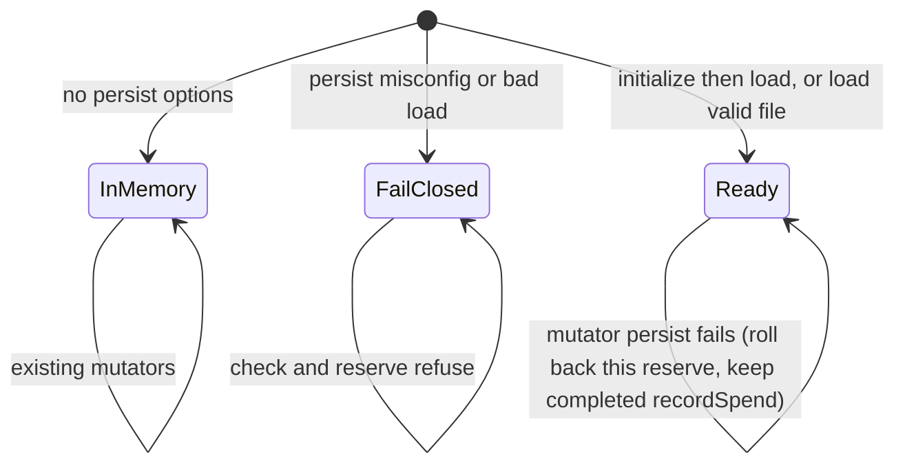
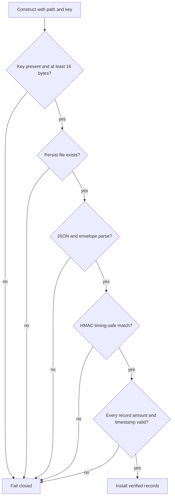

# SpendingPolicy Persist Integrity - Plan

## Goal Capsule

- **Objective:** After a process restart on the same UTC day, an operator who opted into persisted spending still cannot spend more than the daily limit already consumed before the restart. Tampered or unverified history does not reopen that limit.
- **Means:** Opt-in file snapshot of the spend log, HMAC-SHA256 with a caller-supplied key, fail-closed load (KTD1, KTD4).
- **Authority:** Product Contract requirements, then Key Technical Decisions, then Implementation Units.
- **Stop if:** the work would change `src/wallet/crypto.ts`, touch `src/rsi`, edit `.github/workflows/**`, cherry-pick PR #208 or take its `package-lock.json`, add a dependency that is not essential, bump the package version, publish, tag, commit a secret, or force-push.
- **Execution profile:** code. One open pull request. Do not merge.
- **Who finishes:** `ce-work` implements; LFG reviews and opens the PR. Security Officer review is requested on the PR, not performed in this run.

---

## Product Contract

### Summary

Add opt-in, integrity-protected persistence for `SpendingPolicy` so daily spend survives restart. This plan resolves issue #126 in-house and replaces outside PR #208. Persistence only.

### Problem Frame

`SpendingPolicy` keeps `spendingLog` in a private in-memory array. `getDailySpent()` sums that array. A crash or redeploy mid-day starts a new instance at zero, so the advertised daily cap is per-process-lifetime. README Quick Start presents `$25/day` with no caveat. Consumers have no public rehydrate path that preserves verified history.

### Key Decisions

- Persist the spend log with integrity protection. (session-settled: user-directed — chosen over unsigned or in-memory-only persistence: a restart must not silently reopen the daily cap.) Governs R1, R2.
- Tampered, unsigned, or malformed state is rejected; the policy refuses spends and does not reset to zero. (session-settled: user-directed — chosen over fail-open reset: an attacker who edits or deletes history must not regain budget.) Governs R3, R8.
- Reject records with future timestamps (small documented clock skew) and `amount <= 0`. (session-settled: user-directed — chosen over accepting any stored row: a forged future or non-positive row must not distort counters.) Governs R4.
- Import must never lower counters below what the verified log supports. No API that wholesale-replaces the log with caller-supplied unverified data. (session-settled: user-directed — chosen over a raw seed-log constructor: unverified caller JSON must not under-count spend.) Governs R5, R9.
- Persistence only. (session-settled: user-directed — chosen over folding in weekly limits, domain/alias APIs, EIP-191, Tier 3 derivation, or RSI audit work: those are other #126 findings or #208 extras.) Governs R6, R7.

### Requirements

**Persistence and integrity**

- R1. A caller who supplies a persist path and an integrity key can restart a process and observe the same UTC-day spend that the previous instance recorded.
- R2. Persisted bytes are integrity-protected so an attacker who can write the file, but does not have the key, cannot produce a state the policy accepts.
- R4. On load, any record with non-finite or `amount <= 0`, or with `timestamp` after `now + CLOCK_SKEW_MS`, poisons the load. The policy fails closed. Bad rows are not dropped.

**Fail-closed**

- R3. Tampered MAC, missing or blank or too-short key, missing persist file after initialize, unsigned envelope, or malformed JSON causes the policy to refuse spends and to leave counters unrestored rather than zero.
- R8. A persist I/O failure during a mutation does not leave a reservation handle that `PaymentExecutor` could settle, and does not throw into the executor `catch` that marks unknown.

**Counters and import**

- R5. Daily spent is always the sum of verified in-memory records for the current UTC day. A stored counter field, if present, is ignored.
- R9. There is no public method that accepts a caller-supplied record array or JSON blob and installs it without HMAC verification.

**Scope and shipping**

- R6. Existing `SpendingPolicy({ dailyLimit, transactionLimit, allowedDomains })` construction and in-memory tests keep working. Persistence is opt-in.
- R7. The change does not edit `src/wallet/crypto.ts`, `src/rsi/**`, `.github/workflows/**`, or take PR #208 / its lockfile. No version bump, publish, or tags. No secret in the tree.

### Success Criteria

- Required tests exist and pass: restart round-trip, tampered state, future timestamp, non-positive amount, missing key, corrupted file/JSON.
- Existing `tests/payments/spending.test.ts`, `tests/payments/executor.test.ts`, and `tests/integration/payment-flow.test.ts` still pass without persist options.
- The PR body states it resolves #126 in-house, replaces outside PR #208, and needs Security Officer review.

### Actors

- A1. Library caller / operator — supplies path and key, initializes genesis, restarts the process.
- A2. `PaymentExecutor` — calls reserve/settle/void/unknown synchronously around an MCP await.

### Key Flows

- F1. Restart round-trip
  - **Trigger:** A1 initialized persist, recorded spend, then constructed a new `SpendingPolicy` on the same path and key.
  - **Outcome:** `getDailySpent()` matches the prior instance for the current UTC day. Covers R1, R5.
- F2. Tamper or unsigned load
  - **Trigger:** A1 opens a persist-enabled policy against a file whose MAC, JSON, or records are invalid, or omits the key.
  - **Outcome:** `checkTransaction` / `reserveTransaction` refuse. Counters are not reset to a usable zero budget. Covers R2, R3, R4.
- F3. Reserve then persist
  - **Trigger:** A2 calls `reserveTransaction` on a persist-enabled policy.
  - **Outcome:** The reserved row is on disk before return. A later restart still counts it. Persist failure returns no reservation. Covers R1, R8.

### Acceptance Examples

- AE1. Covers F1 / R1. Given an initialized file and key, when instance A records $15 and instance B loads the same path and key, then B's `getDailySpent()` is 15 and a $20 daily-limit check for $5 is allowed, for $6 is not.
- AE2. Covers F2 / R3. Given a valid file, when the MAC hex is flipped, then a new instance refuses spends.
- AE3. Covers R4. Given a signed file whose only record has `timestamp` more than five minutes in the future, then load fails closed.
- AE4. Covers R4. Given a signed file whose only record has `amount` 0 or negative, then load fails closed.
- AE5. Covers R3. Given `persistPath` and no key, or a blank or sub-16-byte key, then the policy refuses spends.
- AE6. Covers R3. Given a file that is not JSON, or JSON missing required envelope fields, then load fails closed.

### Scope Boundaries

**In scope**

- Opt-in persist on `SpendingPolicy` and tests for the acceptance examples.
- Operator-facing notes in `README.md` and `KNOWN_LIMITATIONS.md`. An Unreleased `CHANGELOG.md` line. No version bump.

**Out of scope / outside this product slice**

- Weekly limit enforcement, new domain-check APIs, alias methods.
- EIP-191 digest, Tier 3 derivation, any edit to `src/wallet/crypto.ts`.
- Any edit under `src/rsi` or to RSI audit chaining.
- Cherry-pick or copy from PR #208, including its `package-lock.json` and its `crypto.ts` / `rsi` hunks.
- `.github/workflows/**`.
- Multi-process writers, encrypted-at-rest payload (HMAC is integrity, not confidentiality), version publish/tags.

**Deferred to Follow-Up Work**

- Cross-restart rollback of an older still-valid HMAC snapshot (same key, fewer rows). Document as a residual; do not add a second watermark store in this PR.
- Shared-file locking for two processes writing one persist path.

---

## Planning Contract

### Key Technical Decisions

- KTD1. **HMAC-SHA256 with a caller-supplied key, not an unkeyed hash chain.** (session-settled: user-directed — chosen over unsigned persistence; HMAC selected over chaining to the RSI audit log: unkeyed SHA-256 in `src/rsi/audit.ts` cannot stop a full-file rewrite, `src/rsi` is out of scope, and the required missing-key test needs a key.) Use `createHmac('sha256', key)` from `node:crypto`. Canonicalize with a library-owned fixed field order after Zod parse. MAC the payload only, store the tag beside it. Compare with equal-length guard then `timingSafeEqual` on digest `Buffer`s. Key at least 16 bytes. Fresh HMAC per compute. No new dependency. Governs R2, R3, R7.
- KTD2. **Persistence is opt-in via persist path plus integrity key.** The three-field constructor stays. Path without a usable key, or key without path, is misconfiguration and fail-closed. Governs R6, R3.
- KTD3. **Mutators stay synchronous and persist before return.** Follow `src/config.ts` sync `fs` plus `src/memory/checkpoint.ts` same-directory tmp + rename. Persist from `reserveTransaction`, `recordSpend`, `voidReservation`, `settleReservation`, and `markReservationUnknown` by serializing the live in-memory records without replacing those object references. On `reserveTransaction` persist failure, roll back the in-memory row and return no reservation; do not throw. On `recordSpend` persist failure, keep the in-memory row so this process still counts the completed spend; do not throw. Governs R8, F3.
- KTD4. **Genesis is exclusive initialize; load never treats a missing file as empty spend.** A named static or module initialize exclusive-creates an empty signed file. It is an operator ritual, not a boot `ensure`. A second initialize on an existing path fails and leaves the file unchanged. Constructor load requires that file. Missing dest, leftover tmp, empty, unsigned, or malformed files fail closed. Load reads the dest path only, never `*.tmp`. A fail-closed instance no-ops all five mutators and writes neither dest nor tmp. Governs R3.
- KTD5. **Counters come only from the verified log.** Envelope may omit a counter field; if present it is ignored. `getDailySpent()` keeps summing records with `timestamp >=` UTC day start, including `reserved` and `unknown`. Persist-enabled `reset()` is a no-op on the in-memory log, so a later mutator cannot persist a newly signed reduced snapshot. Persist-enabled `voidReservation` may drop only an in-process `reserved` handle. `getSpendingLog()` must not hand out live objects that `indexOf` can splice. No public import of unverified records. Governs R5, R9.
- KTD6. **`CLOCK_SKEW_MS` is 300000 (five minutes) and is documented next to the constant.** Future means `timestamp > Date.now() + CLOCK_SKEW_MS`. One bad row poisons the whole load. Governs R4.

### High-Level Technical Design

Load and mutation gates. Directional shape, not an implementation specification.

### Assumptions

- Callers who want cross-restart enforcement opt in and keep the HMAC key outside this package, the same way wallet passphrases are caller-held.
- One process owns one persist file. Concurrent `renameSync` last-writer-wins is unsupported.
- An attacker who also has the caller key can rewrite history. That is key-compromise, not a persist bug.
- Reservation object identity remains in-process. Restart tests construct a second `SpendingPolicy` and assert counters, not `voidReservation` on a pre-restart handle.
- Headless scoping bets above are the inferred persist API shape. Product fail-closed and integrity rules are stated, not inferred.

### Implementation Constraints

- TypeScript ESM, Node `>=22`, existing `zod` only. `node:crypto` and `node:fs` sync APIs.
- Do not copy `loadConfigSafe`, episodic skip-corrupt, or RSI `getHistory` skip-malformed. Those fail open.
- Do not add `src/wallet/crypto.ts` HMAC or digest helpers.
- PR #208 is prior art to avoid, not a source.

### System-Wide Impact

`PaymentExecutor` does not change. It already constructs nothing and calls `reserveTransaction` **before** its `try`. A throw from reserve rejects `executePayment`; it does not mark unknown. A throw from settle/void inside `finishReservation` does mark unknown. KTD3's no-throw rule therefore applies to all five mutators.

Public surface grows by optional constructor fields and one initialize export from `src/payments/index.ts` / `src/index.ts`. Existing three-field callers stay valid.

### Sequencing

U1 tests first so U2 implements to a failing contract. U3 docs after the public options exist.

### Sources and Research

- Issue #126 finding `src-payments-spending-ts-daily-spend-not-persisted`. Other #126 findings are out of scope.
- `src/payments/spending.ts`, `src/payments/executor.ts`, `tests/payments/spending.test.ts`.
- Write pattern: `src/memory/checkpoint.ts` tmp+rename. Sync I/O: `src/config.ts`. Integrity anti-pattern: `src/rsi/audit.ts` unkeyed chain.
- Node 22 `createHmac` / `timingSafeEqual` (current; `Hmac` constructor DEP0181). NIST SP 800-224 / FIPS 198-1: HMAC-SHA256, key at least 128 bits.
- Bake-off not run: after research, unkeyed chaining was not a surviving integrity mechanism.

---

## Implementation Units

### U1. Persistence contract tests

- **Goal:** Lock the required fail-closed and round-trip behaviors before production code changes.
- **Requirements:** R1–R6, R8, R9. AE1–AE6. KTD1–KTD6. Key Decisions on integrity, fail-closed, validation, and import.
- **Dependencies:** none
- **Files:**
  - create `tests/payments/spending-persist.test.ts`
- **Approach:**
  1. Use `mkdtempSync` / `tmpdir()` like `tests/memory/checkpoint.test.ts`.
  2. Cover AE1–AE6 plus the extra scenarios below.
  3. Do not import or copy PR #208 tests.
- **Execution note:** Implement this unit test-first. Tests may fail until U2 lands.
- **Patterns to follow:** `tests/memory/checkpoint.test.ts` temp dirs; `tests/payments/spending.test.ts` assertion style; no stubs.
- **Test scenarios:**
  - Restart round-trip: initialize, record $15, new instance, `getDailySpent()` is 15; $20 daily-limit check allows $5 and denies $6. Covers AE1.
  - Tampered MAC: flip one hex nibble, new instance refuses spends. Covers AE2.
  - Future timestamp: signed record `Date.now() + CLOCK_SKEW_MS + 1` poisons load. Covers AE3.
  - Non-positive amount: signed `amount` 0 and `-1` each poison load. Covers AE4.
  - Missing key: path set, key omitted or empty or 15 bytes, refuses spends. Covers AE5.
  - Corrupted file: raw `not-json` and JSON missing `mac` each poison load. Covers AE6.
  - Reserved and unknown rows survive restart and still count toward the daily cap.
  - Persist I/O failure during reserve: no reservation returned, in-memory daily spend unchanged.
  - Persist-enabled policy through `PaymentExecutor`: persist I/O fail on reserve returns a policy rejection, does not throw, does not mark unknown.
  - Persist-enabled `reset()` then `recordSpend` or reserve: a new instance still reports the pre-reset daily total (KTD5).
  - Initialize on an existing dest fails and leaves the accepted log unchanged.
  - After initialize, deleting the dest file: new instance fails closed (not a usable zero).
  - Signed envelope with a stored counter lower than the record sum: `getDailySpent()` equals the sum.
  - Leftover `*.tmp` beside a valid dest is ignored; dest-missing plus tmp-only fails closed.
  - Public constructor and methods reject an unverified seed or replace payload (R9).
  - After load, `voidReservation` on every object from `getSpendingLog()` leaves `getDailySpent()` unchanged; mutating those objects does not change spend or a later restart total.
  - Persist-enabled `voidReservation` on a settled or unknown in-process handle does not drop the row.
  - Persist-enabled reserve then `voidReservation`, then a new instance reports `getDailySpent()` 0.
  - After a missing or tampered dest, `recordSpend` must not create a signed file a later instance would accept.
  - Three-field constructor without persist options still allows spend (R6).
- **Verification:** `npm test -- tests/payments/spending-persist.test.ts` fails on the new assertions until U2, then passes. Existing payment tests still pass after U2.

### U2. SpendingPolicy HMAC persist

- **Goal:** Persist and reload the spend log with fail-closed integrity so U1 passes and `PaymentExecutor` stays sync.
- **Requirements:** R1–R9. KTD1–KTD6.
- **Dependencies:** U1
- **Files:**
  - modify `src/payments/spending.ts`
  - modify `src/payments/index.ts` to export named initialize and any new persist types
  - modify `src/index.ts` to re-export that initialize from the public barrel
  - test `tests/payments/spending-persist.test.ts`
  - test `tests/payments/spending.test.ts`
  - test `tests/payments/executor.test.ts`
- **Approach:**
  1. Optional persist path and integrity key on the existing options object (KTD2).
  2. Envelope: version, records (`amount`, `timestamp`, `domain`, `state`), mac. Zod-parse. Canonical MAC input is a fixed-key-order serialization of version plus records, never the mac field (KTD1).
  3. Export named initialize. Exclusive-create empty signed dest. Second call on an existing path fails (KTD4).
  4. After a verified load, keep using the in-memory array. Every listed mutator writes tmp then `renameSync` on the dest path before return. Load never reads tmp (KTD3, KTD4).
  5. Fail-closed flag: checks refuse with a clear reason and `remainingDaily` 0. Do not install a partial or empty log after a failed load (KTD4, KTD5).
  6. Helper names and exact option field names are implementation-time.
- **Patterns to follow:** fail-closed `try/catch` already in `checkTransaction`; sync `mkdirSync`/`writeFileSync` from `src/config.ts`; tmp+rename from `src/memory/checkpoint.ts`. Do not call into `src/wallet/crypto.ts` or `src/rsi`.
- **Test scenarios:** U1 owns scenario text. U2 is done when those tests pass and existing spending/executor tests still pass.
- **Verification:** U1 file green. `tests/payments/spending.test.ts` and `tests/payments/executor.test.ts` green. `npm run typecheck` clean. No changes under `src/wallet`, `src/rsi`, or `.github/workflows`.

### U3. Operator docs

- **Goal:** Tell callers how to opt in, how fail-closed behaves, and what this PR does not claim.
- **Requirements:** R6, R7. Success Criteria PR wording.
- **Dependencies:** U2
- **Files:**
  - modify `README.md`
  - modify `KNOWN_LIMITATIONS.md`
  - modify `CHANGELOG.md`
- **Approach:**
  1. Document persist path, key, initialize, five-minute skew, fail-closed load, and that the key is caller-held.
  2. In `KNOWN_LIMITATIONS.md`, name residuals: key compromise, older valid snapshot rollback, clock-forward past UTC midnight, no multi-process lock, crash before rename.
  3. Unreleased changelog line only. Do not bump `package.json` version.
- **Test expectation:** none -- documentation only.
- **Verification:** README Quick Start three-field example still works. New persist notes match U2 behavior. Changelog has no new version heading.

---

## Verification Contract

| Gate | Command / signal | Applies |
|---|---|---|
| Persist tests | `npm test -- tests/payments/spending-persist.test.ts` | U1, U2 |
| Existing spending | `npm test -- tests/payments/spending.test.ts tests/payments/executor.test.ts tests/integration/payment-flow.test.ts` | U2 |
| Full suite | `npm test` | before PR |
| Types | `npm run typecheck` | U2 |
| Lint | `npm run lint` | U2, U3 |
| Build | `npm run build` | before PR |
| Pack | `npm run verify:pack` | before PR |
| Scope | `git diff` contains no `src/wallet/crypto.ts`, `src/rsi/**`, `.github/workflows/**`, no `package-lock.json` from #208, no version bump | all units |

`release:validate` does not apply. No version publish.

---

## Definition of Done

- U1–U3 complete. Abandoned helpers removed from the diff.
- AE1–AE6 and the extra U1 scenarios pass with real files and `node:crypto`, not stubs.
- Fail-closed on tamper, missing key, future timestamp, non-positive amount, and corrupt JSON.
- Import cannot lower counters below the verified log. No unverified replace API.
- Existing in-memory constructor and tests unchanged in behavior.
- One open PR, not merged. Body says it resolves #126 in-house, replaces outside PR #208, and needs Security Officer review.
- Head SHA recorded. CI watched once to a decided status.

---

## Risks & Dependencies

- Wipe-by-delete is fail-closed only because load does not auto-create genesis and initialize is not a boot `ensure` (KTD4).
- A throw from `reserveTransaction` rejects `executePayment` (reserve is outside the executor `try`). A throw from settle/void becomes unknown. KTD3 forbids throws on all five mutators.
- Persist-enabled `reset()` that cleared memory would let the next mutator sign a reduced log. KTD5 makes that reset a no-op.
- HMAC does not detect rollback to an older valid snapshot after restart, or clock-forward past UTC midnight. Documented residuals in U3.
- Crash after tmp write and before rename leaves dest at the previous signed snapshot. Residual, not a no-key forge.
- PR #208 already claims #126. This in-house PR must not take its files or lockfile.
