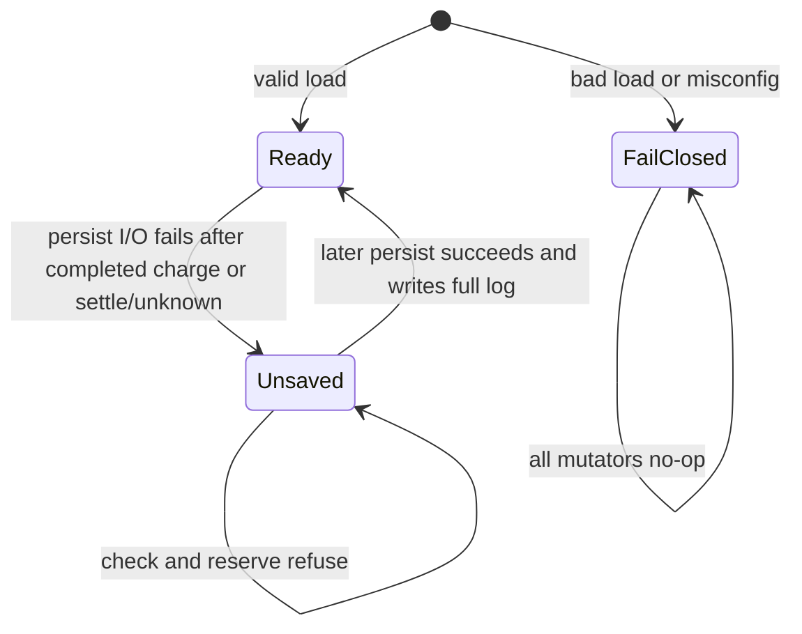
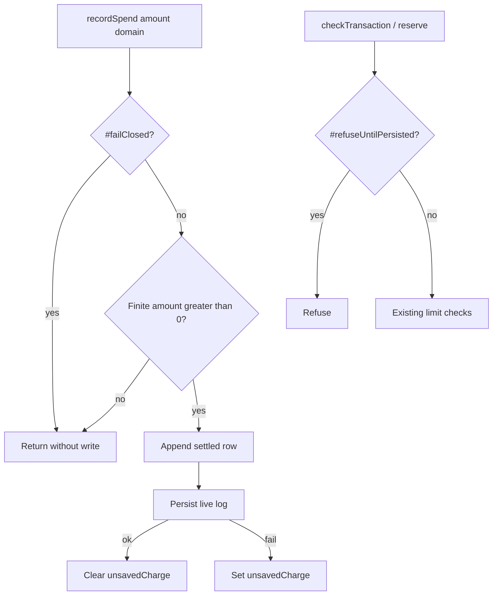

# SpendingPolicy Persist Undercount and SO Hardening - Plan

## Goal Capsule

- **Objective:** After a persist save fails, every completed charge still counts against the daily cap in this process, later approvals stay refused until a save succeeds, and the next good save writes every completed charge so a restart cannot under-count spend.
- **Means:** Keep completed `recordSpend` rows in memory while `#unsavedCharge` is set, and refuse only new approvals until persist recovers (KTD1).
- **Authority:** Product Contract requirements, then Key Technical Decisions, then Implementation Units.
- **Stop if:** the work would change `src/wallet/crypto.ts`, touch `src/rsi`, edit `.github/workflows/**`, add a dependency, edit a lockfile, bump the package version, publish, tag, commit a secret, force-push, delete a branch, push to `cloud/spending-policy-persist-69fa`, or mutate PR #217.
- **Execution profile:** code. One new open pull request into `main`. Do not merge. Body supersedes #217 and links #126 and #220.
- **Who finishes:** `ce-work` implements on a new `cloud/*-bf0b` branch; LFG reviews and opens the PR. Security Officer review is requested on the PR, not performed in this run.

---

## Product Contract

### Summary

Close the round-2 HIGH on parked PR #217: `recordSpend` must not drop completed charges while persistence is failing. Add the Security Officer round-2 items (invalid limits, frozen domain copies, clock-jump-safe prune, private persist directory, handle and chmod tests, one-key-per-file README). Keep every round-1 persist-integrity fix already on `cloud/spending-policy-persist-69fa`.

### Problem Frame

A persist-enabled `SpendingPolicy` that cannot write after the first completed charge currently returns from `recordSpend` without appending. A later successful save therefore writes only the first charge. Restart recovers a daily total that is too low, so spend over the daily limit is allowed. The documented probe is two $10 charges recovered as $10.

Constructor limits that are `NaN` or negative compare as never greater than any amount, so every spend is allowed. The caller’s `allowedDomains` array is stored and returned by `toJSON`, so a caller can extend the allowlist after construction. Compaction uses wall-clock UTC midnight, so a forward clock jump can permanently erase today’s rows from the signed file. The persist parent directory is created with default mode.

### Key Decisions

- Completed charges stay in memory when persist I/O fails; only new approvals refuse until a later save succeeds. (session-settled: user-directed — chosen over dropping `recordSpend` while `#unsavedCharge` is set: a completed charge has already happened and must not vanish from the daily total.) Governs R1, R2, R3.
- Reject non-finite or negative daily and per-transaction limits at construction. (session-settled: user-directed — chosen over treating `NaN`/negative as unlimited: those values currently allow every spend.) Governs R4.
- Copy and freeze `allowedDomains` so the caller’s array is not retained or returned. (session-settled: user-directed — chosen over sharing the caller reference: `toJSON` and later `push` must not enlarge the allowlist.) Governs R5.
- Prune persisted rows only older than day-1 relative to the maximum UTC day seen in the log, not solely wall-clock today. (session-settled: user-directed — chosen over compacting everything before `getUtcDayStart(now)`: a forward clock jump must not permanently erase today’s signed spend.) Governs R6.
- Create the persist directory with mode `0700` and document that it must be private. (session-settled: user-directed — chosen over default `mkdir` mode: the dest and temp files are HMAC-integrity state, not world-writable scratch.) Governs R7.
- README states one integrity key per persist file. (session-settled: user-directed — chosen over leaving key-to-file binding implicit: signed data has no path binding.) Governs R8.
- Ship on a new branch and a new PR that supersedes #217. Do not push to `cloud/spending-policy-persist-69fa` and do not touch #217. (session-settled: user-directed — chosen over updating the parked draft: #217 stays parked.) Governs R10.

### Requirements

**Completed-charge accounting**

- R1. `recordSpend` appends every finite positive completed charge even while a prior persist write is failing.
- R2. While any completed charge or reservation state change is unsaved, `checkTransaction` and `reserveTransaction` refuse. `recordSpend` does not refuse.
- R3. The next successful persist writes every completed in-memory charge. A new instance on the same path and key reports the full daily total.

**Constructor hardening**

- R4. Non-finite or negative `dailyLimit` or `transactionLimit` is rejected at construction. Zero remains a valid “no spend” limit.
- R5. The policy stores a frozen copy of `allowedDomains`. Mutating the caller array, or the array returned by `toJSON`, does not change later domain checks.

**Persist file safety**

- R6. Compaction drops only rows older than the UTC day before the maximum UTC day observed in the live log. Yesterday’s and today’s rows relative to that max day stay. A forward clock jump does not erase today’s signed spend.
- R7. `initializeSpendingPersist` and persist writes create missing parent directories with mode `0700`. Operator docs state the persist directory must be private.
- R8. README states one integrity key per persist file and that the key’s purpose is HMAC integrity of that file.

**Round-1 preserved**

- R9. Keep `#integrityKey`, WeakMap reservation state with frozen handles, exclusive `O_EXCL` `0600` temp + fsync + rename + directory fsync, fail-closed tamper/unsigned/missing/malformed load, and the existing symlink and edited-field-with-old-MAC tests.
- R10. No edits to `.github/workflows/**`, `src/wallet/crypto.ts`, `src/rsi/**`, or lockfiles. No new dependencies. Never create, print, or store tokens. Never read `.env`, `.secrets/`, or `.state/`.

### Success Criteria

- A test reproduces two $10 completed charges while persist I/O fails, asserts in-memory daily spent is $20, and after a later successful save a new instance reports $20 and refuses further spend against a $20 daily limit.
- Tests cover forged handles, other-policy handles, refuse-state clearing after a good save, non-root `0700` directory mode, invalid limits, frozen `allowedDomains`, and clock-jump-safe prune.
- Existing persist integrity tests still pass, including tamper, symlink, exclusive initialize, and key-hiding.
- README documents one key per file and a private persist directory.
- One new open PR into `main` whose body says it supersedes #217 and links #126 and #220.

### Actors

- A1. Library caller / operator — constructs the policy, supplies path and key, records completed charges, restarts the process.
- A2. `PaymentExecutor` — calls reserve/settle/void/unknown around an MCP await. Unchanged.

### Key Flows

- F1. Two completed charges during persist failure
  - **Trigger:** A1 records two $10 spends while the persist directory is not writable, then the directory becomes writable and a later persist succeeds.
  - **Outcome:** In-memory daily spent is $20 during the outage. After recovery a new instance reports $20. Covers R1, R2, R3.
- F2. Approvals refuse, completed charges do not
  - **Trigger:** Persist I/O fails after a completed charge.
  - **Outcome:** `checkTransaction` / `reserveTransaction` refuse. A further `recordSpend` still appends. Covers R1, R2.
- F3. Clock-jump prune
  - **Trigger:** Today’s signed rows exist; wall clock jumps forward more than one UTC day; a mutator persists.
  - **Outcome:** Today’s rows remain in the signed file. Only rows older than the max observed day minus one UTC day are dropped. Covers R6.

### Acceptance Examples

- AE1. Covers F1 / R1 / R3. Given daily limit $20 and a writable dest, when persist I/O is denied, `recordSpend(10)` then `recordSpend(10)` run, then persist recovers, then a new instance loads the same path and key, then `getDailySpent()` is 20 and `checkTransaction(1)` is refused.
- AE2. Covers F2 / R2. Given `#unsavedCharge`, when `checkTransaction(1)` is called, then it is refused; when `recordSpend(10)` is called, then daily spent increases by 10.
- AE3. Covers R4. Given `dailyLimit: Number.NaN` or `transactionLimit: -1`, when the constructor runs, then it throws and no spend is possible.
- AE4. Covers R5. Given a caller array `['a.com']` that is later `push`ed `'evil.com'`, when `checkTransaction` runs for `evil.com`, then it is refused.
- AE5. Covers F3 / R6. Given a signed row from today, when `Date.now` jumps two UTC days forward and a mutator persists, then the signed file still contains today’s row.
- AE6. Covers R7. Given a missing nested persist parent and a non-root process, when `initializeSpendingPersist` runs, then that created directory’s mode is `0700`.

### Scope Boundaries

**In scope**

- `src/payments/spending.ts` behavior listed above.
- Tests in `tests/payments/spending-persist.test.ts` and constructor/limit tests in `tests/payments/spending.test.ts`.
- Operator notes in `README.md` and `KNOWN_LIMITATIONS.md`. Unreleased `CHANGELOG.md` line. No version bump.

**Out of scope / outside this product slice**

- Weekly limits, domain/alias APIs, EIP-191, Tier 3 derivation, `src/wallet/crypto.ts`, `src/rsi/**`.
- `.github/workflows/**`, lockfiles, new dependencies, version publish/tags.
- Updating or commenting on PR #217. Pushing to `cloud/spending-policy-persist-69fa`.
- Multi-process file locking. Encrypted-at-rest payload. Monotonic anti-rollback watermark store.

**Deferred to Follow-Up Work**

- Cross-restart rollback of an older still-valid HMAC snapshot (same key, fewer rows). Remains a documented residual.
- Shared-file locking for two processes writing one persist path.

### Sources

- Parked draft PR #217 and second-model verification at head `9499de827117f4bb26fb9efccfb699a7803ef54a` (HIGH: `recordSpend` drops completed charges).
- Issue #220 SO follow-ups F1–F5. F1–F4 are already on the starting branch; F5 and the listed round-2 items remain.
- Issue #126 persist integrity origin. Prior plan `docs/plans/2026-10-31-1250-fix-spending-policy-persist-plan.md`.
- Live code: `src/payments/spending.ts` `recordSpend` at the `#refuseUntilPersisted()` early return; `#compactPriorUtcDays` using `getUtcDayStart(now)`; `ensureParentDir` without mode; constructor assigning `allowedDomains` and limits by reference.

---

## Planning Contract

### Key Technical Decisions

- KTD1. **`recordSpend` never consults `#refuseUntilPersisted`.** (session-settled: user-directed — chosen over the current early return: a completed charge must stay in `#spendingLog`.) Fail-closed instances still no-op mutators. After append, persist; on I/O failure set `#unsavedCharge`. `#refuseUntilPersisted` remains the gate for `checkTransaction` and `reserveTransaction` only. Governs R1, R2, R3.
- KTD2. **Constructor throws on non-finite or negative limits.** Zero is allowed. Apply before persist load so a poisoned limit never constructs. Governs R4.
- KTD3. **Store `Object.freeze([...allowedDomains])`.** `toJSON` returns a new array copy, not the stored reference. Governs R5.
- KTD4. **Compact against the maximum UTC day start present in the live log, not solely wall-clock today.** Drop rows with `timestamp < maxObservedDayStart - MS_PER_UTC_DAY`. Keep yesterday relative to that max day. Wall-clock `now` still bounds daily spent to the current UTC day. Governs R6.
- KTD5. **`mkdirSync(dir, { recursive: true, mode: 0o700 })` for persist parents.** Do not `chmod` an already-existing caller directory. Document that the persist directory must be private (mode `0700`, not group/world writable). Governs R7.
- KTD6. **README: one key per file, and that key is for that file’s HMAC only.** Signed bytes have no path binding. Governs R8.
- KTD7. **Preserve round-1 internals.** Do not revert `#integrityKey`, WeakMap handles, exclusive random temp, fsync/rename/dir-fsync, empty-path rejection, or settle-after-release throw. Governs R9.
- KTD8. **New branch from `cloud/spending-policy-persist-69fa`, new PR into `main`.** Do not push the parked branch. Do not comment on #217. Review-thread replies in the exact form `Maintainer (bot): fixed in <sha>` apply only to threads on the new PR. Governs R10.

### High-Level Technical Design

### Assumptions

- Headless inferred bets: constructor throws (does not fail-closed) on invalid limits so in-memory callers cannot construct an unlimited policy; `toJSON` returns a fresh copy rather than the frozen internal array.
- Compaction keyed on max log day plus keep-yesterday is enough to survive a multi-day forward jump without a separate persisted watermark.
- `mkdir` mode `0700` is masked by umask for non-root; the non-root test asserts the created directory is not group/world writable.
- Existing test `drops prior UTC-day rows from the next persist snapshot` must change: a yesterday row is kept; only rows older than day-1 relative to the max observed day are dropped.

### Implementation Constraints

- TypeScript ESM, Node `>=22`, existing `zod` only. `node:crypto` and `node:fs` sync APIs.
- Start from the current checkout of `cloud/spending-policy-persist-69fa`. Create `cloud/spending-persist-undercount-bf0b` (or the run’s `cloud/*-bf0b` name). Never push the parked branch.
- Do not read `.env`, `.secrets/`, or `.state/`. Do not create, print, or store tokens.
- Reply to any review thread this run fixes on the new PR with exactly `Maintainer (bot): fixed in <sha>`.

### System-Wide Impact

`PaymentExecutor` stays unchanged. `recordSpend` remains void and non-throwing. In-memory policies without persist options keep working, except they now throw on non-finite or negative limits.

### Risks

- Changing compaction will fail the current “drop yesterday” test unless that test is rewritten to use a two-days-ago row.
- Recursive `mkdir` mode does not chmod an existing parent; tests must create a nested missing directory.
- Clock-jump tests must stub `Date.now` used by `recordSpend` and `getUtcDayStart`.

### Open Questions

None blocking. Residual rollback-to-older-valid-snapshot and multi-process lock stay documented, not built.

---

## Implementation Units

### U1. Keep completed charges while persist is failing

- **Goal:** Two completed $10 charges during a persist outage remain $20 in memory and on the next good save.
- **Requirements:** R1, R2, R3. Approach cites KTD1.
- **Files:** `src/payments/spending.ts`, `tests/payments/spending-persist.test.ts`
- **Approach:** Remove the `#refuseUntilPersisted()` early return from `recordSpend`. Keep the fail-closed no-op and the non-positive amount guard. Append the settled row, persist, and set `#unsavedCharge` on I/O failure. Leave `#refuseUntilPersisted` on `checkTransaction` and `reserveTransaction`.
- **Execution note:** Write the two-$10 regression first, confirm it fails on current `recordSpend`, then apply the production change.
- **Test scenarios:**
  - Happy path: daily limit 20, dest initialized, directory chmod 0555, `recordSpend(10)` then `recordSpend(10)`, `getDailySpent()` is 20, `checkTransaction(1)` is refused. Restore 0755, trigger persist (check or a no-op approval path that retries save), new instance `getDailySpent()` is 20 and `checkTransaction(1)` is refused.
  - Edge: while unsaved, a third `recordSpend(5)` also stays in memory (25) and the later save writes all three.
  - Error: fail-closed instance still ignores `recordSpend` and does not create a dest.
  - Integration: after a good save, `#unsavedCharge` is clear and `checkTransaction` under the remaining budget is allowed.
- **Verification:** `npx vitest run tests/payments/spending-persist.test.ts`

### U2. Constructor limits and frozen allowlist

- **Goal:** Invalid limits cannot construct, and the caller cannot grow `allowedDomains`.
- **Requirements:** R4, R5. Approach cites KTD2, KTD3.
- **Files:** `src/payments/spending.ts`, `tests/payments/spending.test.ts`
- **Approach:** Throw when `dailyLimit` or `transactionLimit` is not finite or is negative. Assign `this.allowedDomains = Object.freeze([...options.allowedDomains])`. `toJSON` returns `{ ..., allowedDomains: [...this.allowedDomains] }`.
- **Test scenarios:**
  - Error: `dailyLimit: Number.NaN`, `dailyLimit: -1`, `transactionLimit: Number.POSITIVE_INFINITY`, `transactionLimit: -0.01` each throw.
  - Happy path: `dailyLimit: 0` constructs and refuses every positive spend.
  - Edge: caller `const domains = ['a.com'];` then `domains.push('evil.com')` after construction; `evil.com` is refused. `toJSON().allowedDomains.push('evil.com')` does not allow `evil.com`.
- **Verification:** `npx vitest run tests/payments/spending.test.ts tests/payments/spending-persist.test.ts`

### U3. Clock-safe prune, private directory, docs

- **Goal:** A forward clock jump cannot erase today’s signed spend; persist parents are created private; README states one key per file.
- **Requirements:** R6, R7, R8, R9. Approach cites KTD4, KTD5, KTD6, KTD7.
- **Files:** `src/payments/spending.ts`, `tests/payments/spending-persist.test.ts`, `README.md`, `KNOWN_LIMITATIONS.md`, `CHANGELOG.md`
- **Approach:** Compute `maxObservedDayStart` from live log timestamps (and treat an empty log as wall-clock today). Delete only rows with `timestamp < maxObservedDayStart - MS_PER_UTC_DAY`. Create missing persist parents with mode `0700`. Keep exclusive temp, fsync, rename, and dir fsync. Document private directory and one key per file. Rewrite the existing prior-UTC-day test to drop a two-days-ago row and keep yesterday.
- **Test scenarios:**
  - Happy path: signed row at `dayStart - 1` (yesterday) plus today’s `recordSpend` persist keeps both rows.
  - Edge: signed row at `dayStart - MS_PER_UTC_DAY - 1` (before yesterday) is dropped on the next persist.
  - Error / clock jump: stub `Date.now` two UTC days forward, persist a new charge, signed file still contains the original today’s row.
  - Non-root chmod: skip when `process.getuid() === 0`; otherwise `initializeSpendingPersist` on a missing nested parent yields directory mode `0700` (not group/world writable).
  - Forged handle: a plain object with `state: 'reserved'` does not void a live row; `settleReservation` on it throws.
  - Other-policy handle: a reservation from policy A is rejected by policy B.
  - Refuse-state clearing: after chmod restore, a successful persist allows a later in-budget `checkTransaction`.
- **Verification:** `npx vitest run tests/payments/spending-persist.test.ts tests/payments/spending.test.ts`

### U4. Ship the new PR

- **Goal:** One new open PR into `main` that supersedes #217 and links #126 and #220.
- **Requirements:** R10. Approach cites KTD8.
- **Files:** none beyond the units above.
- **Approach:** Commit on `cloud/spending-persist-undercount-bf0b`. Push only that branch. Open a new PR. Do not merge. Do not push or comment on #217.
- **Test expectation:** none -- shipping unit.
- **Verification:** PR URL exists, base is `main`, body contains supersedes #217 plus #126 and #220.

---

## Verification Contract

- `npx vitest run tests/payments/spending.test.ts tests/payments/spending-persist.test.ts tests/payments/executor.test.ts`
- `npm run lint`
- `npm run typecheck`
- `npm test`
- `npm run build`
- Do not run or edit `.github/workflows/**`.

## Definition of Done

- U1–U3 implemented and the two-$10 case is a named passing test.
- Round-1 persist integrity tests still pass.
- Docs state one key per file and a private persist directory.
- New PR open against `main`, not merged, superseding #217, linking #126 and #220.
- CI decided on that PR.

## Appendix

Round-1 already present on the starting branch and must remain: `#integrityKey`, WeakMap `#handles`, frozen reservation accessors, `writeExclusiveFile` `wx` `0600`, random `.spend-<hex>.tmp`, fsync file and directory, empty `persistPath` throw, settle-after-release throw, tamper and symlink tests.
